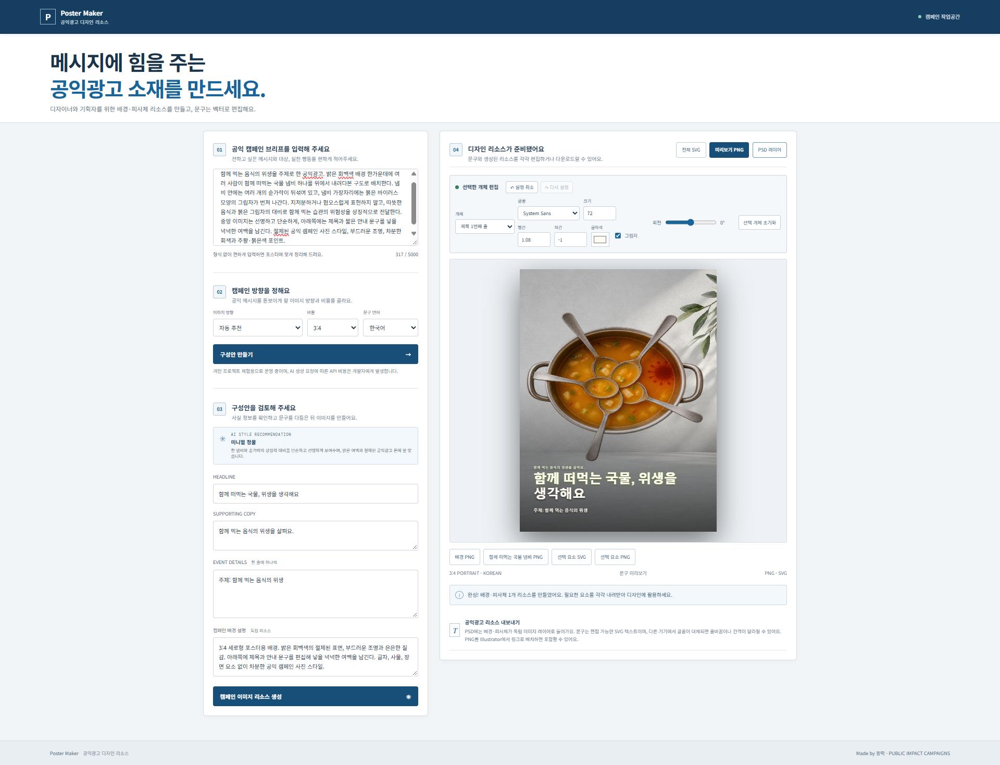
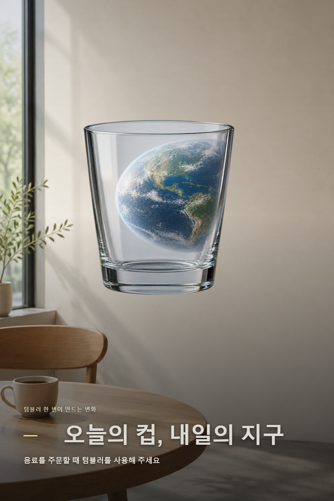
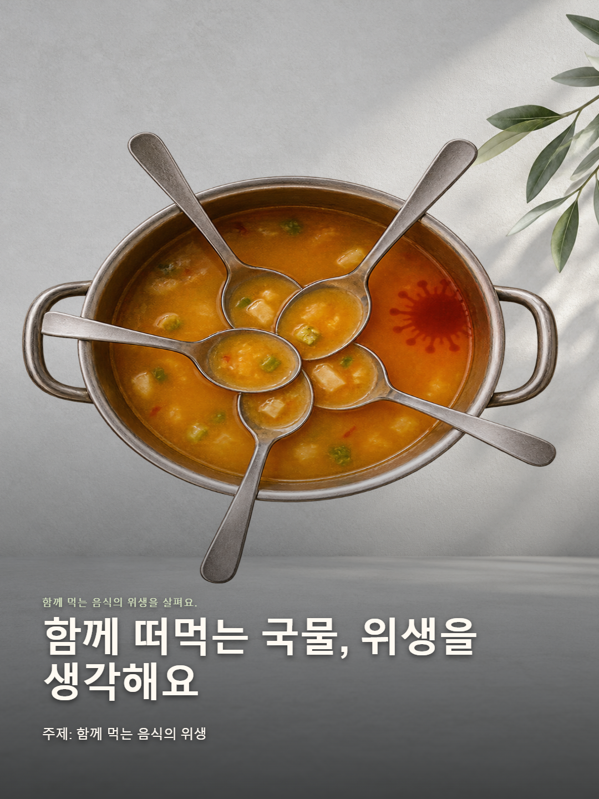

<div align="center">

# Poster Maker

### 공익 메시지를 위한 디자인 리소스

포스터 디자이너와 기획자가 공익광고의 핵심 시각 요소를 만들고 가져갈 수 있도록 돕는 개인 프로젝트입니다.

[**라이브 데모 열기 →**](https://poster-maker-5mv7.onrender.com/)

<br>


</div>

---

공익 캠페인 내용을 입력하면 AI가 메시지 문구와 이미지 리소스 구성을 제안합니다. 차분한 배경과 핵심 피사체 하나를 만들고, 텍스트는 벡터로 편집하거나 배경·피사체를 개별 파일로 가져갈 수 있습니다.

## 화면 미리보기

<div align="center">
  
  <p><em>캠페인 구성안을 확인하고, 생성된 리소스와 문구를 편집하는 작업 화면</em></p>
</div>

## 생성 예시

<table>
  <tr>
    <td align="center" width="50%"></td>
    <td align="center" width="50%"></td>
  </tr>
  <tr>
    <td align="center"><sub>텀블러 사용 캠페인</sub></td>
    <td align="center"><sub>함께 먹는 음식 위생 캠페인</sub></td>
  </tr>
</table>

## 주요 기능

- **공익광고에 맞춘 4가지 이미지 방향:** 공익 캠페인 시네마틱, 미니멀 정물, 인물 중심 다큐멘터리, 에디토리얼 캠페인
- **6가지 포스터 비율:** 정사각형, 세로형, 가로형
- **한국어·영어·일본어** 문구 생성
- **스타일 추천:** 원하는 스타일을 고르거나 AI 추천 사용
- **핵심 이미지 리소스 생성:** 공익 캠페인 메시지에 맞춘 배경과 상징 피사체 하나를 각각 생성
- **개별 자산 저장:** 배경 PNG, 투명 피사체 PNG, 선택 문구 SVG/PNG
- **레이어 PSD 저장:** 배경과 상징 피사체를 독립 이미지 레이어로 제공
- **전체 SVG·PNG 저장:** 텍스트는 편집 가능한 SVG 벡터 문구로 유지
- **크레딧 소진 안내:** API 잔액이나 사용 한도에 도달하면 안내 문구 표시

## 기술 스택

| 영역 | 사용 기술 | 역할 |
| --- | --- | --- |
| 화면 | HTML, CSS, Vanilla JavaScript | 포스터 입력·편집 UI, 미리보기, 다운로드 |
| 서버 | Node.js 20+, ES Modules, `node:http` | 정적 파일 제공 및 API 요청 처리 |
| 생성형 AI | OpenAI Responses API | 문구 정리, 캠페인 방향 추천, 이미지 리소스 구성안 작성 |
| 이미지 생성 | OpenAI Images API | 배경과 핵심 상징 피사체 하나 생성 |
| 파일 출력 | SVG, Canvas API, PNG, PSD | 벡터 텍스트, 독립 PNG 자산, 배경·피사체 PSD 레이어 생성 |
| PSD 작성 | `ag-psd` | 브라우저에서 배경·피사체 이미지 레이어 PSD 생성 |
| 배포 | Render Web Service | 웹 앱 배포와 서버 환경 변수 관리 |

Node.js 내장 기능과 브라우저 API를 중심으로 구성하고, PSD 파일을 만들 때 `ag-psd`를 사용합니다.

## 최근 업데이트

- 피사체 후보 선택 단계를 없애고, 캠페인 메시지에 맞는 핵심 피사체 하나를 자동으로 구성·생성하도록 변경했습니다.
- 피사체 생성 프롬프트가 선택된 콘셉트와 다른 이미지로 벗어나지 않도록 보완했습니다.
- 밝은 화면에서 단계 설명과 문구 입력 안내가 잘 보이도록 글자 색상을 정리했습니다.
- 공개 체험 중 발생하는 AI API 사용 비용은 프로젝트 개발자 계정에 청구된다는 안내를 추가했습니다.
- 푸터에 제작자 표기 `Made by 동딱`을 추가했습니다.

## 사용 흐름

1. 공익 캠페인 메시지나 아이디어를 입력합니다.
2. 스타일, 비율, 문구 언어를 선택합니다.
3. AI가 작성한 제목·보조 문구·세부 정보와 배경 설명을 확인하고 필요하면 수정합니다.
4. AI가 캠페인 메시지에 맞춰 구성한 핵심 피사체를 확인합니다.
5. 캠페인 배경과 핵심 상징 피사체 하나를 각각 이미지 리소스로 생성합니다.
6. 배경·피사체·문구를 개별 파일로 받거나, PSD 리소스 파일로 저장합니다.

## SVG 편집 안내

전체 SVG와 선택 요소 SVG는 **Adobe Illustrator** 또는 **Inkscape**에서 열어 문구 줄을 각각 선택하고 편집할 수 있습니다. 폰트는 Apple SD Gothic Neo, Malgun Gothic 등 운영체제 글꼴을 우선 사용하도록 설정했습니다. 받는 기기에 해당 글꼴이 없으면 대체 글꼴이 적용되어 줄바꿈이나 간격이 달라질 수 있습니다. 결과 모양을 고정해야 한다면 Illustrator에서 복사본의 텍스트를 윤곽선으로 변환하세요.

- 생성 배경은 하나의 래스터 이미지입니다. 배경 안의 개별 사물까지 자동으로 분리되지는 않습니다.
- 상징 피사체 PNG는 투명 배경이며 배경과 별도로 내려받을 수 있습니다.
- PSD는 배경과 피사체를 각각 래스터 레이어로 포함합니다. 편집 가능한 문구는 PSD에 넣지 않으며 SVG에서 따로 다룹니다.
- Illustrator의 링크 패널에서 PNG를 링크로 배치하면 필요할 때 **이미지 포함(Embed Images)** 기능을 사용할 수 있습니다. 생성 SVG의 이미지들은 이미 SVG 안에 포함되어 있습니다.
- 전체 PNG는 완성 화면의 미리보기이며, 개별 배경·피사체 PNG도 각각 받을 수 있습니다.

## 로컬에서 실행하기

### 준비물

- Node.js 20 이상
- API 사용이 가능한 OpenAI API 키

저장소를 내려받습니다.

```bash
git clone https://github.com/Dong-DDack/Poster-Maker.git
cd Poster-Maker
```

프로젝트 최상위 폴더에 `.env` 파일을 만들고 API 키를 입력합니다.

```env
OPENAI_API_KEY=발급받은_API_키
```

서버를 실행합니다.

```bash
npm install
npm start
```

## Render 배포

GitHub 저장소를 연결해 **Web Service**를 생성하고 아래 명령을 지정합니다.

| 설정 | 값 |
| --- | --- |
| Build Command | `npm install` |
| Start Command | `npm start` |
| Environment Variable 이름 | `OPENAI_API_KEY` |
| Environment Variable 값 | 본인의 OpenAI API 키 |

키는 Render 서비스의 **Environment** 설정에만 입력하세요. 공개 데모 방문자의 요청은 서버에 등록한 소유자의 API 잔액을 사용합니다. Render 무료 서비스는 일정 시간 접속이 없으면 잠들 수 있어, 다시 접속할 때 첫 응답이 늦어질 수 있습니다.

## 비용 및 사용 시 참고

- 문구 구성, 배경 생성, 핵심 피사체 생성은 각각 별도 API 요청이며 사용료가 발생할 수 있습니다.
- 공개 데모는 제작자의 개인 API 키를 사용합니다. 방문자의 요청도 제작자 계정의 크레딧을 소모하며, 크레딧이나 사용 한도가 소진되면 이미지 생성이 중단됩니다. 다시 사용하려면 제작자가 크레딧을 충전해야 합니다.
- 공개 데모에는 로그인이나 사용자별 사용량 제한이 없습니다. API 사용량은 OpenAI Usage에서, 호스팅 사용량은 Render Billing에서 확인하세요.
- 생성된 문구와 이미지의 날짜, 장소, 가격, 링크 등 사실 정보를 저장 전에 확인하세요.
- 이 데모는 개인 프로젝트 및 실험용입니다.

## 라이선스

현재 별도 오픈소스 라이선스가 지정되어 있지 않습니다. 코드의 재사용이나 재배포 전에 저장소 소유자에게 문의해 주세요.
